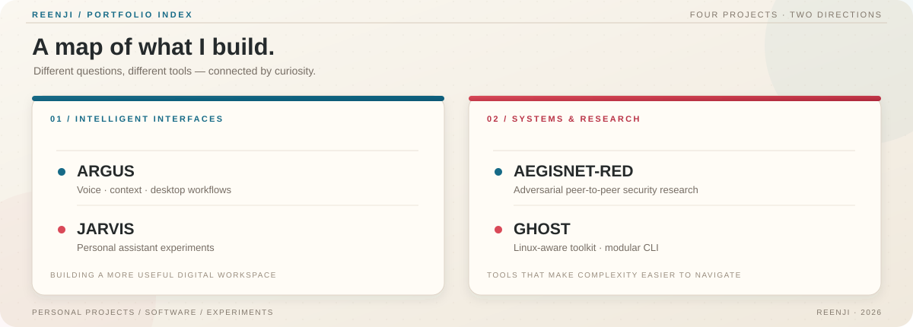

<!--
  Profile README for github.com/reenji
  Keep this file in a public repository named exactly: reenji
  Local artwork: assets/renji-profile.png
  Custom project map: assets/project-atlas.svg
-->

  <table width="100%" border="0" cellpadding="0" cellspacing="0">
    <tr>
      <td width="43%" align="center" valign="middle">
        
      </td>
      <td width="57%" valign="middle">
        
<strong>INDEPENDENT DEVELOPER · SOFTWARE · AI</strong>

        <h1>Ideas deserve to become real things.</h1>
        
I’m <strong>Reenji</strong> — a developer exploring the intersection of intelligent software, useful tooling, and systems that reward a closer look.

        
I build across different disciplines, from AI assistants and desktop experiences to command-line tools and security research. Each project has its own purpose, visual language, and set of problems to solve.

        

          
          
        

        
CURIOUS BY DEFAULT. PARTICULAR ABOUT THE DETAILS.

      </td>
    </tr>
  </table>

  

    <a href="#the-way-i-build">The approach</a> &nbsp; / &nbsp;
    <a href="#project-atlas">Project atlas</a> &nbsp; / &nbsp;
    <a href="#selected-work">Selected work</a> &nbsp; / &nbsp;
    <a href="#toolbox">Toolbox</a> &nbsp; / &nbsp;
    <a href="#github-observatory">GitHub activity</a>
  

---

## The way I build

I’m interested in the moment an idea becomes something tangible: a tool with a clear purpose, an interface that feels considered, or a system whose behavior is easier to understand.

I don’t work in just one lane. My repositories explore a few connected themes:

<table>
  <tr>
    <td width="33%" valign="top">
      
<strong>01 / INTELLIGENCE</strong>

      <h3>Make software more helpful.</h3>
      
Assistants, voice-driven interaction, contextual tools, and workflows that bring multiple capabilities into one place.

    </td>
    <td width="33%" valign="top">
      
<strong>02 / CRAFT</strong>

      <h3>Make tools feel coherent.</h3>
      
Desktop experiences, terminal utilities, automation, and the small implementation choices that make software easier to use.

    </td>
    <td width="33%" valign="top">
      
<strong>03 / SYSTEMS</strong>

      <h3>Understand what sits underneath.</h3>
      
Security research, distributed environments, and tooling that helps investigate how systems behave.

    </td>
  </tr>
</table>

## Project atlas

  

## Selected work

FOUR PROJECTS · FOUR DIFFERENT REASONS TO BUILD

<table>
  <tr>
    <td width="50%" valign="top">
      
01 &nbsp; / &nbsp; INTELLIGENT DESKTOP

      <h2><a href="https://github.com/reenji/Argus">ARGUS ↗</a></h2>
      
<strong>A desktop AI assistant designed around interaction.</strong>

      
ARGUS brings Gemini Live into a desktop workspace with voice and text interaction, optional browser, file, screen and messaging tools, contextual research, and a dedicated studio for creating and editing editable presentations.

      

        
        
        
      

      
<a href="https://github.com/reenji/Argus">Explore the repository and documentation →</a>

    </td>
    <td width="50%" valign="top">
      
02 &nbsp; / &nbsp; PERSONAL AI

      <h2><a href="https://github.com/reenji/jarvis">JARVIS ↗</a></h2>
      
<strong>An assistant-oriented project space.</strong>

      
JARVIS sits in the personal-assistant side of my work: a place to explore how software can bring capabilities together around a user. Check the repository for its current implementation and development history.

      

        
        
      

      
<a href="https://github.com/reenji/jarvis">Explore JARVIS →</a>

    </td>
  </tr>
  <tr>
    <td width="50%" valign="top">
      
03 &nbsp; / &nbsp; SECURITY RESEARCH

      <h2><a href="https://github.com/reenji/aegisnet-red">AEGISNET-RED ↗</a></h2>
      
<strong>Exploring adversarial peer-to-peer systems.</strong>

      
A security research framework focused on adversarial P2P environments. The project explores the challenges that arise when connected systems must be understood under less predictable conditions.

      

        
        
      

      
<a href="https://github.com/reenji/aegisnet-red">Explore AEGISNET-RED →</a>

    </td>
    <td width="50%" valign="top">
      
04 &nbsp; / &nbsp; LINUX TOOLING

      <h2><a href="https://github.com/reenji/Ghost">GHOST ↗</a></h2>
      
<strong>A modular home for security-oriented command-line tools.</strong>

      
GHOST is a distro-aware terminal launcher that can check dependencies, work with the system package manager, record activity, and be extended through modular tool categories and shell plugins. Intended for authorized labs and defensive research.

      

        
        
        
      

      
<a href="https://github.com/reenji/Ghost">Explore GHOST →</a>

    </td>
  </tr>
</table>

  <a href="https://github.com/reenji?tab=repositories"><strong>Browse all repositories →</strong></a>

---

## Toolbox

These technologies appear across the projects or their documented architecture. Individual repositories have their own requirements and setup instructions.

**Languages & environments**

**Application & service technologies**

---

## GitHub observatory

A few different views of what gets built here: overall activity, languages represented in public code, contribution rhythm, and activity over time.

  
  

  

  

  
   
  

These cards rely on third-party services; their availability and refresh timing may vary. Language cards reflect repository data, not a complete measure of skill.

---

## Around the web

  <a href="https://github.com/reenji">GitHub</a> &nbsp; · &nbsp;
  <a href="https://x.com/Reenjixd">X / Twitter</a> &nbsp; · &nbsp;
  <a href="https://reenji.bearblog.dev/">Personal blog</a>
    
  Thanks for taking a look around.

  

