<!--
  reenji · GitHub profile README
  Keep the assets/ folder next to this file:
  assets/banner.svg · assets/reenji-card.png · assets/footer.svg
-->

<div align="center">



<picture>
  <source media="(prefers-color-scheme: dark)" srcset="https://readme-typing-svg.demolab.com?font=JetBrains+Mono&weight=500&size=22&duration=3000&pause=1000&color=39FF14&center=true&vCenter=true&width=650&height=45&lines=Building+intelligent+systems.;Exploring+AI+%26+cybersecurity.;Automate.+Analyze.+Build.;Every+trace+tells+a+story.">
  
</picture>

</div>


### 👻 `$ cat README.md`

I'm **reenji** — a developer building intelligent systems, exploring cybersecurity, and creating tools that make technology more capable.

My work lives where **AI assistants**, **automation**, **security research** and **terminal-based tooling** meet. I like experimenting with ideas, engineering practical solutions, and understanding how systems work beneath the surface. Currently developing projects across AI, security, and developer tooling.

```console
reenji@soul-society:~$ whoami
reenji // AI · security · automation

reenji@soul-society:~$ ls ~/projects
jarvis/  argus/  aegisnet-red/  ghost/

reenji@soul-society:~$ cat /etc/motto
EVERY TRACE TELLS A STORY.
```

<br clear="right"/>

## `$ ls ~/projects`

### 🧠 Artificial Intelligence

<table>
<tr>
<td width="50%" valign="top">

<h3>🤖 JARVIS</h3>

An AI-focused project exploring the development of a personal intelligent assistant — bringing AI capabilities and useful tools together in a unified experience.

<code>AI</code> <code>Assistants</code> <code>Automation</code>

<a href="https://github.com/reenji/jarvis">

</a>

</td>
<td width="50%" valign="top">

<h3>👁️ ARGUS</h3>

A desktop AI assistant powered by **Gemini Live** — voice interaction, contextual tools, research capabilities and file workflows. Also includes a **presentation studio** for creating and editing PowerPoint decks.

<code>Python</code> <code>AI</code> <code>Voice</code> <code>Desktop Applications</code>

<a href="https://github.com/reenji/Argus">

</a>

</td>
</tr>
</table>

### 🛡️ Cybersecurity & Systems

<table>
<tr>
<td width="50%" valign="top">

<h3>🔴 AEGISNET-RED</h3>

An adversarial peer-to-peer (**P2P**) security research framework — a project focused on exploring security concepts in distributed and interconnected systems.

<code>Python</code> <code>P2P</code> <code>Security Research</code>

<a href="https://github.com/reenji/aegisnet-red">

</a>

</td>
<td width="50%" valign="top">

<h3>👻 GHOST</h3>

A modular, Linux-aware terminal hub for cybersecurity and penetration-testing tools. Features distribution detection, package-manager integration, dependency checks, execution logging, customizable modules and extensibility.

<code>Bash</code> <code>Linux</code> <code>CLI</code> <code>Security Tooling</code>

<a href="https://github.com/reenji/Ghost">

</a>

</td>
</tr>
</table>

## `$ cat /interests`

```text
[01] Artificial Intelligence & AI Agents
[02] Cybersecurity & Security Research
[03] Automation & Developer Tooling
[04] Linux & Terminal Environments
[05] Software Engineering & System Design
[06] Privacy, Infrastructure & Networking
```

## `$ tech --interests`

<p align="center">
  
  
  
  
  
  
  
</p>

<p align="center">
  <sub><i>Technologies and interests represented here reflect my projects and areas of exploration, not necessarily proficiency in every tool.</i></sub>
</p>

## `$ git stats`

<p align="center">
  
  
</p>

<p align="center">
  
</p>

## `$ connect --with reenji`

<p align="center">
  <a href="https://github.com/reenji">
    
  </a>
  <a href="https://github.com/reenji?tab=repositories">
    
  </a>
  <a href="https://x.com/Reenjixd">
    
  </a>
  <a href="https://reenji.bearblog.dev/">
    
  </a>
</p>

<div align="center">

<br/>



<sub>Security research and tooling shown here are for education and authorized testing only.</sub>

</div>
